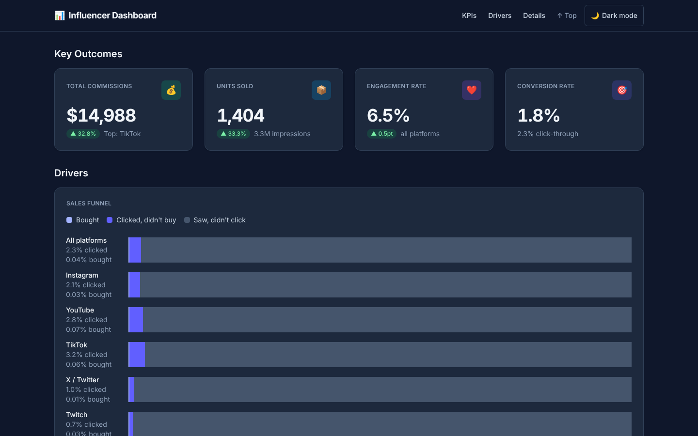

# Influencer Dashboard

A one-page reporting dashboard for a multi-platform influencer. It brings commissions, sales, conversions and engagement from five platforms (Instagram, YouTube, TikTok, X / Twitter, Twitch) and three affiliate products into one view, so the creator can see what earns, what drives it, and what needs attention.

<picture>
  <source media="(prefers-color-scheme: light)" srcset="resources/screenshots/hero-light.png">
  
</picture>

Full-page screenshots at 375, 768, 1024 and 1440px in both themes are in [`resources/screenshots/`](resources/screenshots/).

## What's on the page

The page reads top to bottom, from outcomes to causes to the rows behind them.

| Block | Shows |
|---|---|
| **Key Outcomes** | Total commissions, units sold, average engagement rate and conversion rate, with the change vs last month on the first three. |
| **Drivers** | The sales funnel (100% stacked bars per platform, per-step comparisons and a step-rate table), commission share by platform, performance by product, content activity and engagement by platform. |
| **Operational Details** | Alerts and improvement opportunities, platform / product / campaign tables with alert markers on the related rows, and top performers by commission and by return. |

It is dark by default, with a light theme toggle in the header that remembers your choice. It works from phone width up, with keyboard navigation and a skip link.

## Run it

You need Python 3.

```bash
pip3 install -r requirements.txt
python3 server.py
```

Then open <http://localhost:3000>.

There is no build step. Tailwind CSS v4 (browser build) and [Charts.css](https://chartscss.org/) load from a CDN, so the page needs an internet connection.

## The data

All numbers are **generated mock data**, not a real creator's figures. `scripts/generate-data.py` builds `data.js` (which sets `window.DATA`) from a fixed seed, precomputes every rollup the page shows, and runs invariant checks so the totals agree with each other. `app.js` only renders what's in `window.DATA`, so the page could be pointed at a real API with the same shape.

To regenerate after changing the generator:

```bash
python3 scripts/generate-data.py
```

The schema is described in [`resources/mock-data-plan.md`](resources/mock-data-plan.md).

## Project layout

| Path | What it is |
|---|---|
| `index.html` | The page: sticky header and the three blocks. |
| `app.js` | Renderers, one function per component. |
| `data.js` | Generated mock data. Don't edit by hand. |
| `scripts/generate-data.py` | Deterministic data generator with invariant checks. |
| `server.py` | Small Flask dev server on port 3000. |
| `resources/design-spec.md` | **The design spec**: layout, colours, type, components, section content and definition of done. |
| `resources/decisions.md` | Log of design decisions and why they were made. |
| `resources/profile.md`, `resources/brief.md` | The client persona and the original brief. |
| `resources/status.md` | What's built and what's next. |
| `AGENTS.md`, `.agents/rules/` | Working instructions for AI coding agents that help build the project. |
| `archive/` | Superseded planning notes, kept for history. Not current; see [`archive/README.md`](archive/README.md). |

## Status

The dashboard is complete against the design spec. It has no console errors, no horizontal scroll at 375 to 1440px, and no axe-core accessibility violations in either theme. ROI is the creator's return on commission: (commission − spend) ÷ spend. Possible next steps are in [`resources/status.md`](resources/status.md).
